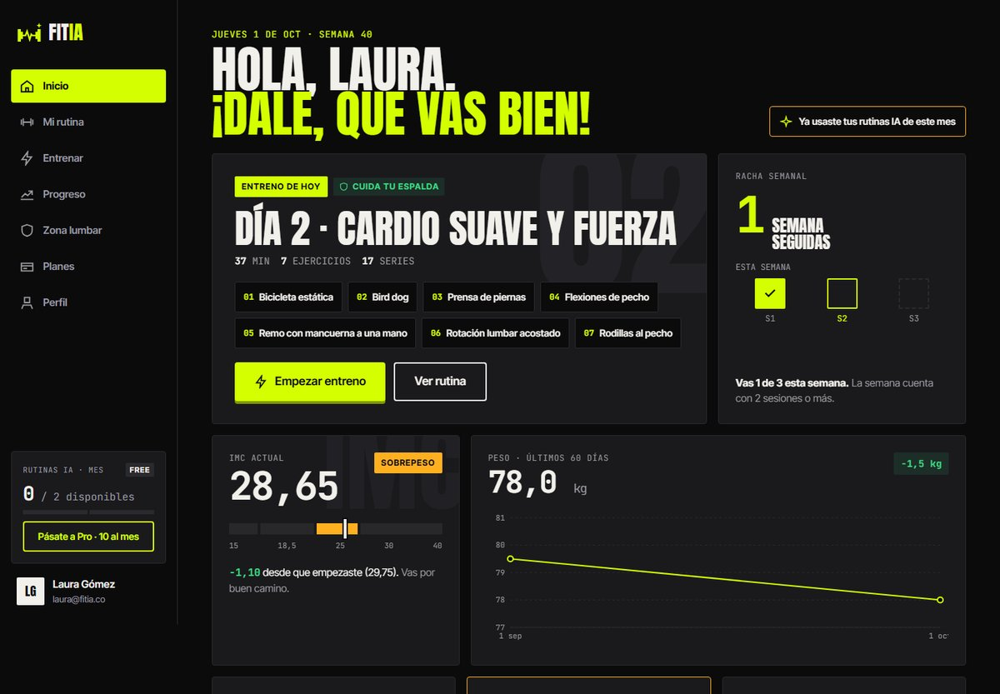
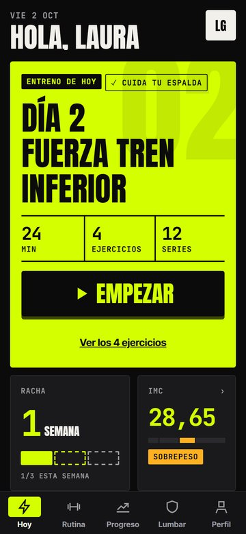
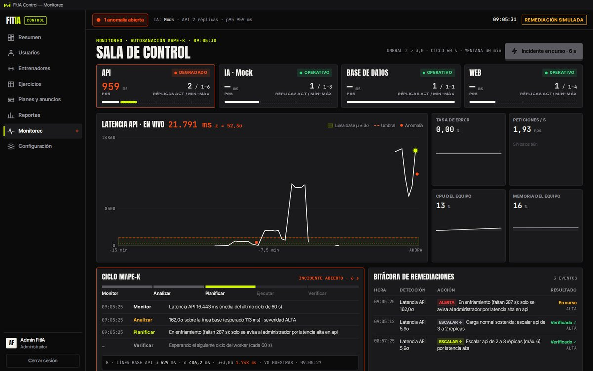

# FitIA — Entrenamiento personalizado con IA

Plataforma web, app móvil y aplicación de escritorio que genera rutinas de ejercicio **seguras** según el IMC y las molestias de cada persona, pensada para gimnasios de barrio y para quien entrena sin entrenador. Proyecto Integrador CUN 2026: **Bases de Datos · Arquitectura de Software · Innovación Tecnológica de Redes**.

Equipo: Juan Diego Reyes · Juan Delgado · Vanesa Vargas · Santiago Castañeda

| Web (usuario) | App móvil | FitIA Control (escritorio) |
|---|---|---|
|  |  |  |

Más capturas en [`docs/capturas/`](docs/capturas/).

---

## Los 3 entregables

| Entregable | Tecnología | Para quién | Qué hace |
|---|---|---|---|
| **Página web** | React + Vite | Visitantes y usuarios | Landing, calculadora de IMC, planes y toda la app del usuario |
| **App móvil** | React Native (Expo) | Usuarios en el gimnasio | Rutina del día, modo entreno con cronómetro, progreso |
| **Ejecutable (.exe)** | Electron → `FitIA Control Setup.exe` | Admin y entrenadores | Gestión, reportes y **consola de monitoreo en vivo** |

Los tres consumen **una sola API REST** (Flask, `/api/v1`) conectada a **MySQL 8**.

## Qué aporta a cada materia

| Materia | Qué se muestra |
|---|---|
| **Bases de Datos** | Modelo ER de 27 tablas en 3FN, IMC como columna generada, 5 triggers (uno bloquea ejercicios peligrosos), 3 procedimientos con transacción, 6 vistas, 12 índices, roles de MySQL con mínimo privilegio → `database/`, `docs/diagramas/01` |
| **Arquitectura de Software** | Cliente-servidor en capas, una API para 3 clientes, patrones Strategy, Repository, Chain of Responsibility y Circuit Breaker; modelo incremental en 7 etapas → `docs/02_arquitectura.md`, `docs/diagramas/02-06` |
| **Innovación en Redes** | Topología en Packet Tracer (VLAN, router-on-a-stick, DHCP, DNS, ACL, WiFi WPA2) y monitoreo autónomo MAPE-K: línea base dinámica, anomalías por z-score, auto-escalado simulado; Nginx como proxy inverso en Docker → `docs/diagramas/04` y `07` |

---

## Opción A — Todo con Docker (un solo comando)

Requisitos: **Docker Desktop** abierto. No hace falta instalar MySQL, Python ni Node.

```bash
git clone https://github.com/juanreyes3101/FitIA.git
cd FitIA
docker compose up --build
```

La primera vez tarda unos minutos (descarga imágenes, compila la web y carga la base de datos). Cuando la consola muestre `fitia-web` y `fitia-api` corriendo:

| Qué | Dónde |
|---|---|
| Página web | **http://localhost:8080** |
| API (para el celular y FitIA Control) | `http://localhost:5000/api/v1` · desde el celular: `http://<IP-del-PC>:5000/api/v1` |
| MySQL (Workbench) | `127.0.0.1`, puerto **3307**, usuario `root`, clave `RootDocker2026*` |

Qué levanta (`docker-compose.yml`, diagrama completo en [`docs/diagramas/08_despliegue_docker.png`](docs/diagramas/08_despliegue_docker.png)):

```
             ┌──────────── Nginx (web) ────────────┐
navegador ──►│ :8080  web compilada + /api ────────┼──► api (Flask, gunicorn) ──► db (MySQL 8)
celular  ───►│ :5000  solo la API ─────────────────┘                           ▲
FitIA Control┘                                             worker (MAPE-K) ────┘
```

- **db**: MySQL 8. La primera vez carga `schema.sql`, `seed.sql`, `roles_usuarios.sql` y crea `fitia_app` con `rol_api` (mínimo privilegio). Los datos quedan en el volumen `fitia_datos`.
- **api**: la API Flask. No publica puertos: solo se llega a ella a través de Nginx.
- **worker**: el ciclo MAPE-K cada 15 s (para la demo).
- **web**: Nginx sirve la web y hace de proxy inverso, con cabeceras de seguridad (CSP, `X-Frame-Options`, etc.).

Comandos útiles:

```bash
docker compose up -d --build      # en segundo plano
docker compose logs -f api worker # ver qué pasa
docker compose down               # apagar (los datos se conservan)
docker compose down -v            # apagar y BORRAR la base de datos (se recarga desde los .sql)
```

- La IA arranca en `mock`. Si `backend/.env` tiene `AI_PROVIDER=gemini` y `GEMINI_API_KEY`, Docker los toma de ahí (ese archivo nunca se sube a GitHub).
- Las claves por defecto de `docker-compose.yml` son **solo para la demo local**. Para cambiarlas, crea un `.env` junto a `docker-compose.yml` con `FITIA_DB_ROOT_PASSWORD`, `FITIA_DB_PASSWORD` y `JWT_SECRET_KEY`, y corre `docker compose down -v` antes de subirlo de nuevo.
- Docker usa los puertos 5000, 8080 y 3307: apaga `npm run api:lan` antes de levantarlo.

## Opción B — Sin Docker (desarrollo en Windows)

Requisitos: Git, Node 20+, Python 3.12+ y MySQL 8 con Workbench.

```bash
git clone https://github.com/juanreyes3101/FitIA.git
cd FitIA
npm install                                   # web, escritorio y código compartido
npm --prefix apps/mobile install              # la app móvil va aparte (React 19)
cd backend
python -m venv .venv
.venv\Scripts\pip install -r requirements.txt
cd ..
```

1. **Base de datos** (Workbench o consola, en este orden): `database/schema.sql` → `database/seed.sql` → `database/roles_usuarios.sql`.
2. **Variables**: copia `.env.example` a `backend/.env` y llena `DB_USER`, `DB_PASSWORD` y `JWT_SECRET_KEY`. Copia `apps/web/.env.example` a `apps/web/.env`.
3. **Levanta cada parte en su propia terminal**:

| Terminal | Comando | Qué levanta |
|---|---|---|
| 1 | `npm run api:lan` | API en el puerto 5000 |
| 2 | `npm run worker` | Monitoreo MAPE-K |
| 3 | `npm run web` | Web en **http://localhost:5173** |
| 4 | `npm run desktop` | FitIA Control (escritorio) |
| 5 | `npm run movil` | Expo: escanea el QR con Expo Go |

Problemas frecuentes:

| Síntoma | Solución |
|---|---|
| `Fatal error in launcher: Unable to create process` | El proyecto se movió de carpeta después de crear el `.venv`. Bórralo (`Remove-Item -Recurse -Force backend\.venv`) y créalo de nuevo |
| `"expo" no se reconoce como un comando` | Falta `npm --prefix apps/mobile install` |
| El celular no conecta | PC y celular en la misma WiFi, red de Windows en **Privada**, `npx expo start -c` en `apps/mobile` |
| iPhone pide iniciar sesión en Expo Go | Usa la misma cuenta de Expo en el PC y el iPhone, o arranca con `npx expo start --offline` |

### Ejecutable e instalador

- `npm run desktop:dist` genera `apps/desktop/release/FitIA Control Setup.exe` (sin firma: en SmartScreen, **Más información → Ejecutar de todas formas**). El instalado necesita la API corriendo.
- El APK de Android se genera con el plan gratuito de Expo: ver `apps/mobile/README.md`. Antes, pon la IP del PC en `apps/mobile/eas.json`.

---

## Usuarios demo

| Rol | Correo | Clave | Para qué |
|---|---|---|---|
| Administrador | `admin@fitia.co` | `Admin2026*` | FitIA Control: gestión y monitoreo |
| Entrenador | `coach@fitia.co` | `Demo2026*` | Revisar y aprobar rutinas |
| Usuaria | `laura@fitia.co` | `Demo2026*` | Sobrepeso + dolor lumbar (IMC 28,65) |
| Usuario | `andres@fitia.co` | `Demo2026*` | Bajo peso, plan Pro |

## Pruebas

```bash
cd backend && .venv\Scripts\python -m pytest          # 69 pruebas automáticas (API, validador, triggers, MAPE-K)
python backend/scripts/prueba_punta_a_punta.py         # flujo completo contra la API que esté corriendo
python backend/scripts/prueba_punta_a_punta.py http://localhost:8080/api/v1   # lo mismo, pasando por Nginx (Docker)
```

La prueba de punta a punta recorre 19 pasos: registro → onboarding → medición (el trigger asigna OBESIDAD) → rutina con IA validada → ningún ejercicio contraindicado → sesión de entreno → progreso → pago Pro simulado → el admin ve el pago, los reportes y el monitoreo → MAPE-K detecta un pico → limpieza.

## Estado por etapas (modelo incremental)

| Etapa | Qué | Estado |
|---|---|---|
| 1 | Diseño de identidad y pantallas | ✅ `docs/diseno/` |
| 2 | Base de datos y diagramas | ✅ `database/`, `docs/diagramas/` |
| 3 | Backend: API + IA + validador | ✅ `backend/` |
| 4 | Web | ✅ `apps/web/` |
| 5 | App móvil | ✅ `apps/mobile/` |
| 6 | Monitoreo MAPE-K + ejecutable | ✅ `backend/app/monitoring/`, `apps/desktop/` |
| 7 | Docker, seguridad, prueba de punta a punta, manual y guion | ✅ `docker-compose.yml`, `docs/04`, `docs/05` |

---

## Presupuesto $0 — todo gratis, sin tarjeta

| Necesidad | Solución gratis | Notas |
|---|---|---|
| Código | **GitHub** | Repositorio público |
| Base de datos | **MySQL Community + Workbench** | Software libre |
| Backend | **Python + Flask** | Libre |
| Web, móvil y escritorio | **React, Expo y Electron** | Libres |
| **Inteligencia artificial** | **Google Gemini por AI Studio** (capa gratuita) + **modo Mock** | Sin tarjeta. **No activen la facturación** en Google Cloud. Si se acaba la cuota, FitIA pasa sola al modo Mock |
| Contenedores | **Docker Desktop** + imágenes oficiales (MySQL, Python, Node, Nginx) | Gratis para uso educativo |
| Celular | **Expo Go** y plan gratuito de Expo (APK) | iOS se muestra con Expo Go |
| Ejecutable | **electron-builder** | Instalador sin firma digital |
| Red | **Cisco Packet Tracer** | Gratis con cuenta de NetAcad |
| Pagos | **Simulados** | Sin pasarela real; solo se guardan los últimos 4 dígitos |

**Cuidados con Gemini:** la capa gratuita tiene límites por minuto y por día. Por eso el backend cachea las rutinas 24 h, pone un tope diario (`IA_MAX_SOLICITUDES_DIA`) y solo envía un perfil anónimo (nunca el nombre ni el correo).

## Estructura

```
FitIA/
├── docker-compose.yml   todo el sistema con un comando
├── docker/              Nginx, imagen de la web y usuario de MySQL para Docker
├── backend/             API Flask, IA, validador, monitoreo MAPE-K, pruebas
├── apps/
│   ├── web/             React + Vite
│   ├── mobile/          Expo (React Native)
│   └── desktop/         Electron: FitIA Control
├── packages/shared/     tipos, cliente de la API y tokens de diseño
├── database/            schema.sql · seed.sql · roles_usuarios.sql · Diagrama.mwb
└── docs/
    ├── 02_arquitectura.md          requisitos, decisiones, contrato de la API
    ├── 04_manual_usuario.md        cómo se usa cada aplicación
    ├── 05_guion_sustentacion.md    qué mostrar en 10 minutos
    ├── diagramas/                  ER, casos de uso, secuencia, despliegue, BPMN, componentes, MAPE-K, Docker
    └── capturas/
```
