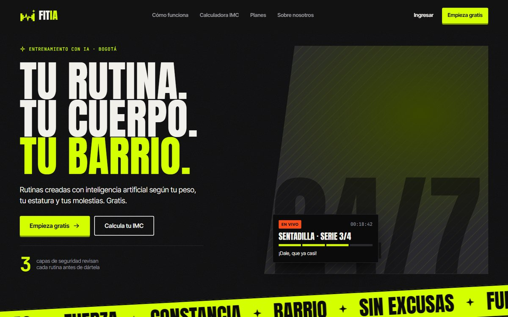
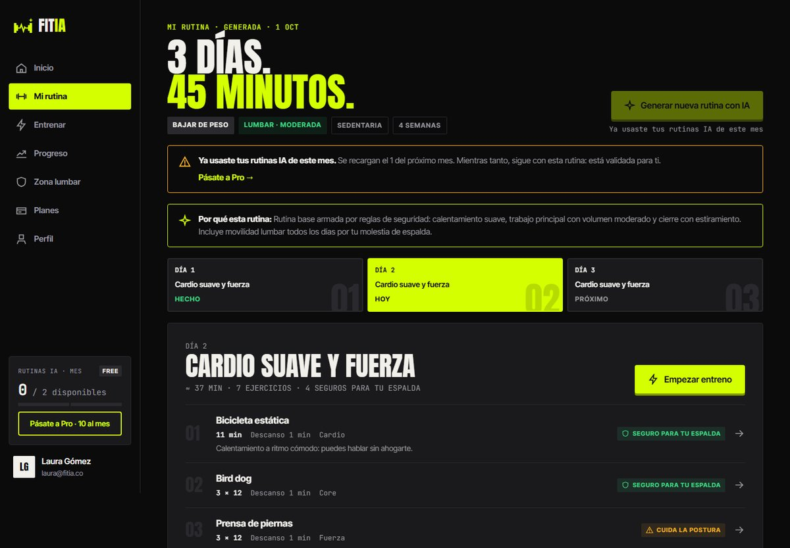
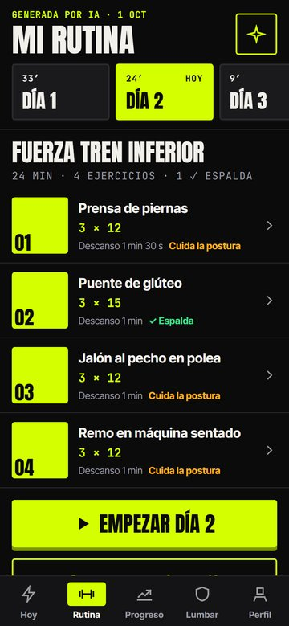
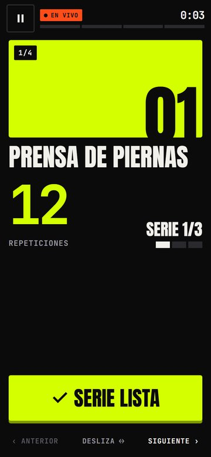
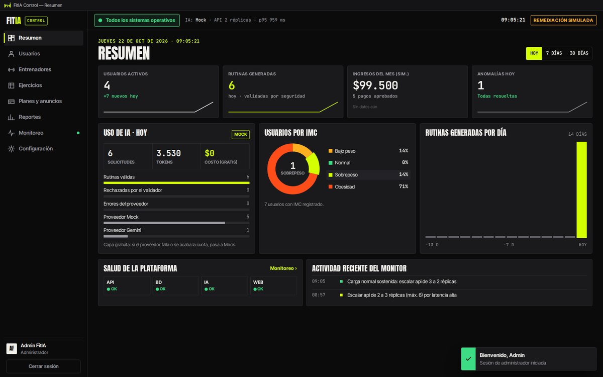

# FitIA — Manual de usuario

FitIA tiene tres aplicaciones que comparten la misma cuenta y los mismos datos:

| Aplicación | Para quién | Cómo se abre |
|---|---|---|
| **Página web** | Cualquier persona y los usuarios registrados | Navegador: `http://localhost:8080` (Docker) o `http://localhost:5173` (desarrollo) |
| **App móvil** | Usuarios, sobre todo en el gimnasio | Expo Go (escanear el QR) o el APK en Android |
| **FitIA Control** | Administrador y entrenadores | Ejecutable de Windows (`FitIA Control Setup.exe`) o `npm run desktop` |

> **Aviso:** FitIA no reemplaza a un médico ni a un fisioterapeuta. Si el dolor es fuerte o no mejora, consulta a un profesional de la salud.

Cómo ponerlo a funcionar: ver el [README](../README.md). Usuarios de prueba: `laura@fitia.co` / `Demo2026*` (usuaria), `coach@fitia.co` / `Demo2026*` (entrenador), `admin@fitia.co` / `Admin2026*` (administrador).

---

## 1. Página web pública (sin cuenta)

| Sección | Qué hace |
|---|---|
| **Inicio** | Explica FitIA en 3 pasos y la sección «Cuidamos tu espalda» |
| **Calculadora IMC** | Escribe tu peso (kg) y estatura (cm). Muestra tu IMC, la clasificación de la OMS (bajo peso, normal, sobrepeso, obesidad) y un mensaje |
| **Planes** | Compara **FitIA Free** ($0, con publicidad, 2 rutinas con IA al mes) y **FitIA Pro** ($19.900/mes o $199.000/año, sin publicidad, 10 rutinas con IA al mes) |
| **Sobre nosotros** | El problema, la misión y el equipo |
| **Ingresar / Empieza gratis** | Iniciar sesión o crear una cuenta |

### Crear una cuenta
1. Pulsa **Empieza gratis**.
2. Escribe nombres, apellidos, correo y una contraseña de **mínimo 8 caracteres**.
3. Acepta los términos y el tratamiento de datos (Ley 1581 de 2012) y pulsa **Crear cuenta**.
4. Quedas en el plan Free y pasas al onboarding.

Por seguridad, después de **5 intentos fallidos en un minuto** hay que esperar un minuto antes de volver a intentar.

---

## 2. App del usuario (web y celular)

La web y la app móvil muestran lo mismo: si registras un entreno en el celular, aparece en la web.

| Web | Celular |
|---|---|
|  |  |

### 2.1 Onboarding (la primera vez, 4 pasos)
1. **Datos básicos:** fecha de nacimiento y sexo.
2. **Peso y estatura:** el IMC se calcula en vivo.
3. **Nivel de actividad y objetivo:** por ejemplo «Sedentario» y «Bajar de peso».
4. **Molestias y tiempo:** dolor lumbar, de rodilla o hipertensión (con su intensidad), días por semana y minutos por sesión.

Al terminar, la IA arma tu primera rutina.

### 2.2 Inicio (Dashboard / Hoy)
- **Entreno de hoy:** el día de la rutina que te toca, con el botón **Empezar entreno**.
- **Racha semanal:** cuántas semanas seguidas has cumplido.
- **IMC actual** con el medidor de colores y tu **peso de los últimos 60 días**.
- **Cupo de IA:** cuántas rutinas con IA te quedan este mes.
- En el plan Free aparece un anuncio.

### 2.3 Mi rutina
- La semana por días (por ejemplo: Día 1 cardio suave + core, Día 2 fuerza tren inferior, Día 3 movilidad lumbar).
- Cada ejercicio muestra series × repeticiones o duración, y el descanso.
- Si reportaste dolor lumbar, el sello **«Seguro para tu espalda»** marca los ejercicios aptos y **«Cuida la postura»** los que requieren más atención.
- **Generar nueva rutina con IA** gasta 1 del cupo del mes.

**¿Por qué mi rutina es segura?** Tiene tres filtros: a la IA solo se le ofrecen los ejercicios permitidos para tus condiciones; un validador revisa 7 reglas antes de guardarla; y la base de datos rechaza cualquier ejercicio contraindicado. Si la IA no responde, FitIA arma la rutina por reglas.

### 2.4 Detalle de un ejercicio
Pasos, músculos que trabaja, errores comunes y por qué se eligió para ti.

### 2.5 Modo entreno
1. Pulsa **Empezar entreno**.
2. Haz cada serie y pulsa **Serie lista**; el cronómetro cuenta el descanso.
3. Al terminar, califica tu **esfuerzo (1 a 10)** y tu **dolor (0 a 10)**.
4. Si el dolor es mayor a 5, FitIA te muestra un mensaje de cuidado y te sugiere movilidad.

| Rutina en el celular | Modo entreno |
|---|---|
|  |  |

### 2.6 Progreso
Peso, IMC, sesiones por semana y dolor promedio, con filtros de 30, 90 y 365 días. Cada vez que registras una medición, FitIA actualiza tu clasificación (por ejemplo, si bajas de sobrepeso a normal, se quita la condición SOBREPESO).

### 2.7 Zona lumbar
Biblioteca de ejercicios de movilidad y estiramiento aptos para dolor lumbar.

### 2.8 Planes y pago (simulado)
1. En **Planes**, elige **FitIA Pro** mensual o anual.
2. Elige el método (tarjeta, PSE o Nequi) y, si es tarjeta, escribe el número.
3. **Es un modo demostración:** no se cobra nada y solo se guardan los últimos 4 dígitos. Para probar un rechazo, usa una tarjeta que termine en `0000`.

### 2.9 Perfil
Datos personales, condiciones de salud, nueva medición de peso y cerrar sesión.

---

## 3. FitIA Control (escritorio)

Solo pueden entrar el **administrador** y los **entrenadores**. Los usuarios normales usan la web o el celular.

| Pantalla | Qué hace |
|---|---|
| **Resumen** | Usuarios activos, rutinas generadas, ingresos simulados, uso de IA y usuarios por IMC |
| **Usuarios** | Buscar y filtrar; ver la ficha; activar, bloquear o cambiar el rol. «Eliminar» solo desactiva la cuenta |
| **Entrenadores** | Cola de **rutinas por revisar**: aprobar, rechazar o ajustar el volumen (series, repeticiones, descanso). El entrenador no puede cambiar un ejercicio por otro |
| **Ejercicios** | Catálogo y **matriz ejercicio × condición**: marcar una celda crea una contraindicación |
| **Planes y anuncios** | Crear y editar planes y anuncios |
| **Reportes** | Ingresos por mes, adherencia y uso de IA; exportar a CSV |
| **Monitoreo** | La sala de control (ver abajo) |
| **Configuración** | URL de la API, proveedor de IA activo y umbrales del detector de anomalías |

### 3.1 Monitoreo (MAPE-K)

- **Tarjetas por servicio** (API, IA, base de datos, web): estado, réplicas y latencia p95.
- **Latencia en vivo** con la banda de la línea base (μ ± 3σ); los puntos rojos son anomalías.
- **Ciclo MAPE-K:** Monitorear → Analizar → Planificar → Ejecutar → Verificar, con la acción tomada.
- **Bitácora de remediaciones:** qué detectó, qué hizo y si quedó verificado.
- **Simular pico de tráfico:** inyecta un pico de latencia para la demostración. En segundos aparece la anomalía y la acción (por ejemplo, escalar de 2 a 3 réplicas). En el ciclo siguiente del worker queda **Verificado** cuando la métrica vuelve a la normalidad.

Para que esta pantalla tenga datos, el **worker** debe estar corriendo (`npm run worker`, o Docker).

---

## 4. Preguntas frecuentes

| Pregunta | Respuesta |
|---|---|
| Dice que no hay conexión con el servidor | La API no está corriendo, o el celular no está en la misma WiFi que el PC |
| «Te quedan 0 rutinas IA» | Se acabó el cupo del mes. Pásate a Pro o espera al mes siguiente; tu rutina actual sigue disponible |
| ¿Qué pasa si la IA no responde? | FitIA usa el generador de respaldo por reglas (Mock), que pasa por los mismos filtros de seguridad. El administrador lo ve en **Resumen → Uso de IA** |
| No puedo entrar a FitIA Control con mi cuenta | Es solo para administrador y entrenadores |
| ¿Se cobra algo? | No. Todos los pagos son simulados |
